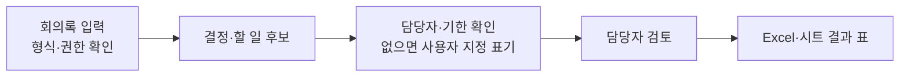

# U-Solve 제품 기획

2026-10-11 기준 **이번 프로토타입의 중심 경험은 실무자의 문서 업무 해결**로 정리했다. [확정 기획 요약](PLAN.md)은 빠른 검토용이며, 이 문서는 결정의 상세 내용·근거·미정 범위를 보존한다. [완료 기준](ACCEPTANCE.md)의 기획 판정과 제품 실행 판정은 별개다. 과거 자료는 [CONTEXT.md](CONTEXT.md)와 `docs/reference/`의 후보안이며 최신 확정 사항이 아니다.

## 현재 선택과 다른 아이디어의 관계

- 박찬건 안의 `업무 설명→회사 조건에 맞는 기존 해법 선택→시뮬레이션→대표 문서 실제 시험`을 이번 프로토타입의 중심 흐름으로 삼는다.
- 김성원 안의 한국어 Threads AI 소식 정리는 별도 가치가 있다. 두 안의 독립·부분 연결·완전 통합 여부는 아직 결정하지 않았으며 **이번 세 문서 사례의 시연 통과 조건이 아니다**.
- 소식에서 업무 적용으로 이동하면 발견과 실행의 근거를 잇는 장점이 있을 수 있지만 수집·저장·적합성 검증을 함께 해야 한다. 독립 흐름은 검증 범위가 좁지만 양쪽 경험의 이동이 약하다. 두 효과는 아직 사용자 시험 전 가설이다.
- 과제 피드백의 협업·연결 요청은 남겨 두되, 통합 확정이나 Threads 자동 수집 성공으로 해석하지 않는다. `interview_20261011_094533`은 기획 인터뷰 기록이다.

## 박찬건 방향의 상세 기획

### 이번 인터뷰에서 확정한 방향

- 첫 검증의 주 사용자는 간단한 문서 작업을 쉽게 처리할 방법을 찾는 실무자다.
- 사용자는 문서 작업을 질문하고, 서비스는 필요한 기술을 요약한 뒤 우리 저장소의 정보를 바탕으로 쓸 수 있는 방법을 제시한다.
- GitHub·오픈소스·그 밖의 출처에서 찾은 방법이 포함될 수 있으며, 비개발자도 이해하고 저비용으로 도입할 수 있어야 한다.
- 우리 저장소는 기술·도구의 설명 정보와 실행 가능한 코드·워크플로를 함께 담는다.
- 작은 작업에 대해 기존 해법을 그대로 사용할 수 있는지, 일부 모듈을 바꾸면 쓸 수 있는지 근거를 제시하고 해당하는 해결책을 안내한다.
- 근거를 갖춘 추천 워크플로는 사용자 여정의 중간 단계다. 사용자의 실제 문서 본문을 읽고 그 내용으로 작업하여 결과물을 검토하는 흐름까지 제품을 단계적으로 키운다. 가능한 범위에서 실제 업무의 AI 전환(AX)도 돕는다.
- 여러 문서의 요약 보고서, 회의록의 할 일·결정 사항 정리, 정해진 양식의 문서 초안 세 사례를 모두 다룬다.
- 먼저 확보 가능한 정보를 모아 작업 명세를 정리하고, 부족한 정보나 할 수 없는 부분은 명시한다.
- 최신 확정: 프로토타입의 주 카테고리는 문서 자동화다. PDF, Docs·Word 문서, Excel·스프레드시트를 다루는 업무를 범위에 둔다. U-Solve의 역할은 이미 제공되는 도구·워크플로를 업무 조건에 맞춰 찾고 연결해 실제 결과를 확인하도록 돕는 것이다. 문서 처리 엔진을 새로 직접 만드는 것을 필수로 두지 않는다.
- 문서 종류가 넓다는 방향과 개별 형식·작업의 지원 여부는 구분한다. 후보 도구의 실제 입력·출력·권한·비용을 확인하지 않은 형식은 처리 가능하다고 약속하지 않는다.
- 최신 확정: 실제 도구를 실행하기 전에 U-Solve 안에서 가정한 업무 흐름과 예상 결과를 시뮬레이션으로 보여준다. 사용자가 방향을 승인하면 필요한 문서·계정·권한·비용 조건을 안내하고 실제 도구 연결·시험 실행으로 넘어간다. 시뮬레이션은 실제 처리 결과나 AX 완료 증거가 아니다.
- 최신 확정: 시각적으로 보여주는 것이 중요하다. 문서 작업에만 한정하지 않고, 복잡한 업무의 과정이나 예상 결과를 이해·판단하는 데 도움이 된다면 U-Solve 안에서 2D 또는 3D 시뮬레이션 보기를 제공하는 방향이다. 어떤 작업에 어떤 표현이 필요한지와 실제 생성·표시 도구는 사례별로 정하고 검증한다.
- 기업 담당자에게는 먼저 해결할 업무, 현재 처리 방식, 원하는 결과를 [기업 업무 요청서](INTAKE.md)에 맞춰 받는다. 실제 처리 전에는 대표 문서·결과 양식·자료 이용 조건·성공 기준을 추가로 확인한다. 공개 레퍼런스 제출을 첫 문의 조건으로 삼지 않는다.
- 작업 명세를 정리한 뒤 해법 정보는 웹에서 바로 조회 가능한 공개 자료에서 필요한 만큼 찾고, 출처·확인 날짜·지원 조건을 저장소에 정리한다. 웹 전체를 미리 가져오는 범위는 잡지 않는다.
- 코멘토 예시는 공개 웹 정보를 한 줄 설명, 주요 기능과 사용자 행동, 근거 링크로 구조화하는 자료 형식의 참고 사례로 삼는다.
- 기획·완료 기준을 먼저 마무리한다. 2026-10-12 월요일 22:00(Asia/Seoul) 전 마감은 그대로다.
- 세 사례 모두 10월 12일 시연에서 실제 문서 본문을 읽고 각각의 결과물까지 보여주는 목표로 확정했다. 내부 시연용 Markdown 문서는 초안으로 작성했으며 파일 첨부·본문 붙여넣기 방식은 확정, 사용자 원본 문서의 지원 파일 형식과 실제 동작은 미정이다.
- 제작자 등록·포트폴리오, 광범위한 자동 수집 등 원문 MVP의 다른 기능은 이번 첫 검증의 필수 범위로 아직 확정되지 않았다.

### 기업 업무 접수와 작업 명세

확정: 최초 접수는 도구 이름을 묻는 대신 `어떤 업무인가 → 지금 어떻게 하나 → 어떤 결과가 필요한가` 세 항목으로 시작한다. 그다음 시뮬레이션 전에 후보를 가르는 원본 위치·형식, 결과 형식, 회사 정책상 외부 AI 사용 가능성, 기존 서비스 종류와 설치·연결 제약만 짧게 묻는다. 비용·기한이 후보 판단을 바꾸면 그 한도도 이때 확인한다. 담당자가 모르는 항목은 `모름`으로 받으며, 답이 없어도 가정과 미확인을 표시한 설계 미리보기는 제공한다. 실제 문서 본문·양식 파일과 실행에 필요한 계정 권한은 방향 승인 뒤 실제 처리 단계에서 요청한다. 그때 문서 파일 첨부를 기본으로 받고 본문 붙여넣기도 허용한다. U-Solve는 받은 답을 업무·현재 절차·입력·출력·조건·미확인 사항이 분리된 작업 명세로 다시 보여준다. 이때 특정 후보의 설치 가능성이나 실행 완료를 단정하지 않는다. 요청서의 세부 문구·파일별 지원 형식·링크 연결 여부는 미정이다.

| 진행 단계 | 기업이 제공할 것 | U-Solve가 할 것 |
|---|---|---|
| 첫 문의 | 해결할 업무 하나, 현재 처리 순서, 원하는 결과와 필수 항목 | 작업 명세 초안과 누락된 정보 목록 |
| 후보 검토·설계 미리보기 | 원본 위치·형식, 결과 형식, 회사 정책상 외부 AI 사용 가능성, 기존 서비스 종류와 설치·연결 제약, 후보 선택에 중요한 비용·기한 한도 중 모르는 항목은 `모름`이라고 답함. 실제 본문·양식·계정 정보 제출은 필요 없음 | 확인된 조건과 가정을 분리해 후보의 근거·변경점을 비교하고, 판정 필수조건이 없으면 개인화 추천·순위·시작 절차와 비용 적합성 단정을 보류한 채 빈 결과 구조의 시뮬레이션을 제시. 공개 도구 예시는 적합성 미판정으로 표시 |
| 방향 승인 뒤 첫 실제 시험 | 파일 첨부 또는 본문 붙여넣기로 대표 입력과 필요한 양식을 제공하고, 해당 문서·도구의 자료 이용·외부 전송·계정 연결·유료 호출 허용 범위와 성공 기준을 확인 | 허용된 경로에서만 후보 도구가 본문·양식을 읽는지 시험하고, 실제 입력·결과와 미확인을 기록. 운영 대상에 반영하기 전 사람 검토와 시험 대상·복구 방법을 확인 |
| 반복 적용 | 반복 빈도·문서량, 관리할 사람과 검토·복구 방식 | 새 문서 재실행과 결과 검토가 확인된 범위만 적용 완료로 표시 |

첫 문의만으로 작업 명세 초안은 만들 수 있다. 문서가 필요한 작업에서 대표 본문이 없으면 내용 기반 결과물은 만들 수 없으며 공개·가상 자료를 이용한 시연은 회사 문서 처리의 검증으로 표시하지 않는다. `그대로 사용 가능` 판단에는 후보의 입력·출력과 회사의 이용 조건이 맞는지 확인해야 한다. 문서 원본·양식·전송 허용 여부 등 필요한 조건이 없으면 그 항목은 미확인이다. 시뮬레이션 방향의 승인은 실제 자료 전송·계정 연결·유료 호출의 허용을 대신하지 않는다.

#### 페르소나 대화로 점검한 공통 흐름 — 내부 합성 검토

`agent/persona-intake`의 합성 운영팀장 요청을 세 차례 대화로 검토했다. 첫 문의 3항목만으로 작업 명세를 만들 수 있지만, Docs·PDF→기존 Sheets인지와 외부 전송 허용 여부를 모르면 공개 템플릿이 이 회사에 맞는다고 확정할 수 없다. 그래서 시뮬레이션 전에 후보를 가르는 메타조건만 묻고, **판정 필수조건이 모르면 가정이 적힌 업무 과정과 빈 출력 구조까지만 시뮬레이션**하며 특정 도구의 개인화 추천·순위·시작 절차는 보류한다. 공개 도구를 보여주더라도 일반 참고 사례·적합성 미판정으로 표시한다. 실제 본문·양식 파일·계정 권한은 방향 승인 뒤 요청한다.

이 규칙은 세 확정 사례에 공통으로 적용한다. 회의록은 결정·할 일·담당자·기한·원문 위치가 있는 빈 표, 여러 문서 요약은 문서별 출처·기간·단위와 충돌 항목이 보이는 빈 보고서 구조, 양식 초안은 필수 항목과 근거 없음 표시가 있는 빈 양식 구조를 미리 보여준다. 사용자가 흐름을 승인해도 **해당 문서와 도구의** 실제 전송·계정 연결·유료 호출 허용은 별도로 확인하고, 실제 본문→결과물·근거를 대조하기 전에는 처리 완료로 표시하지 않는다. 첫 시험에서 운영 시트·공유 문서에 쓰기 전 사람 검토와 시험 대상·복구 방법도 확인한다. 회의록의 빠진 담당자·기한처럼 **업무 결과의 표시 문구는 요청자가 지정한 값**을 따른다. 예컨대 `미확인`을 요청했다면 기본 예시의 `미정`을 강제하지 않으며, 어떤 표현이든 값을 추정하지 않는다. 동일 문서 재실행 시 중복·검토·복구의 반복 운영 기준은 반복 적용을 제공한다고 주장할 때 검증한다. 이 검토는 내부 합성 시나리오이며 실제 고객 인터뷰나 실행 결과가 아니다. PPT·마스킹은 이 대화만으로 필수 범위에 추가하지 않는다.

공개 레퍼런스는 기업이 준비해야 할 자료가 아니다. U-Solve가 작업 명세를 만든 다음, 공개 프로젝트·설명·코드·워크플로의 주장과 이용 조건을 검증하기 위해 찾는다. 앞서 만든 [시연 문서 세트](demo/README.md)는 이 흐름을 시험하기 위한 선택적 내부 자료다.

### 근거와 상태

- [박찬건 개인 Notion 기획](https://recondite-salute-14b.notion.site/3e40a17c91ac80dfb5bee3acc7f49890?pvs=143)을 2026-10-11 연결된 Notion 도구로 읽었다. 도구가 표시한 페이지 최종 수정 시각은 2026-10-10 11:14이다.
- 이 절의 원문 설명은 당시 개인 기획에 적힌 내용이며 지금 승인된 제품 범위나 구현 결과를 뜻하지 않는다.
- 9월 말 협동 초안은 제작자 참여와 여러 출처의 프로젝트 수집을 축소하고 Threads 소식과 결합했으므로 개인안과 구분한다.

### 원문에 적힌 문제와 제안

- 핵심 문제는 실무자가 자기 업무 중 무엇을 자동화할 수 있는지, 흩어진 프로젝트 중 무엇을 고를지, 자기 환경에서 사용 가능한지, 어떻게 첫 사용을 시작할지 판단하기 어렵다는 것이다.
- 사용자는 업무를 기술 용어 없이 설명한다. 플랫폼은 자동화 가능한 단계와 관련 프로젝트를 연결하고 사용 조건·근거·시작 방법을 공통 형식으로 보여주는 안이다.
- 공급자 측에는 제작자가 프로젝트와 활용 사례를 등록하고 포트폴리오를 공개하며, 이용자의 오류 제보와 경험으로 정보를 보완하는 흐름이 있다. 즉 이용자와 제작자 양쪽을 다루는 기획이다.
- 정보 출처는 GitHub API, RSS, 허용된 공개 페이지, 제작자 직접 등록이다. 한국어 Threads 자동 수집은 이 개인안의 명시 핵심 출처가 아니다.
- 원문은 자동 수집, 직접 등록, 검색·필터, 상세 정보, AI 추천, 검수·정보 상태, 저장, 기본 제작자 프로필, 오류 제보를 MVP로 적고 비교 화면과 자세한 후기를 후속 기능으로 둔다. 이는 검토할 후보 범위다.

### 이번 프로토타입의 사용자 흐름

1. 기업 담당자가 해결할 업무, 현재 방식, 원하는 결과를 U-Solve 요청 형식에 맞춰 설명한다.
2. 서비스가 이를 작업 명세로 정리하고, 시뮬레이션 전에는 후보를 가르는 원본·결과 형식과 회사 정책상 전송 가능성·기존 도구 제약, 필요한 비용·기한 한도만 추가로 묻는다. `모름`도 받는다. 실제 문서·양식 파일과 실행 권한은 방향 승인 뒤 확인한다.
3. 필요한 기술·기능을 짧게 요약하고, 자체 저장소의 설명 정보와 코드·워크플로, 확인 가능한 외부 출처에서 후보를 찾는다.
4. 후보의 입력·출력·작업 단계·실행 환경을 작업 명세와 비교한다.
5. 그대로 쓸 수 있으면 시작 절차를, 일부만 다르면 바꿔야 할 단계와 판단 근거를 포함한 추천 워크플로를 제공한다.
6. U-Solve 안에서 가정한 입력→처리→예상 출력의 시뮬레이션을 보여준다. 과정이나 결과의 이해에 도움이 되는 작업은 2D·3D로 시각화하고, 가정·미확인 사항과 실제 실행 전임을 명시한다. 사용자가 결과 방향을 수정하거나 승인한다.
7. 승인 후에만 필요한 실제 문서·양식·도구 계정·권한·비용 조건을 안내하고, 단계별 준비·설정·검증 방법을 지도한다. 허용된 기존 도구·워크플로에 실제 본문을 연결해 시험 실행하고, 입력·실행·결과를 확인한다. 생성된 결과물을 원문·양식과 대조해 확인할 수 있게 한다.
8. 반복할 업무라면 사용자의 필요에 맞춰 도입·적용을 돕는다. 필요한 준비, 비용, 권한, 근거 수준과 남은 확인 사항을 설명하며, 가능한 해법이 없으면 그 이유를 밝힌다.

초기 해법 정보의 출처는 공개 웹 자료로 정했다. 사용자 문서 본문은 실제 처리에 필요하다. 입력 경로는 파일 첨부를 기본으로 하고 본문 붙여넣기도 허용한다. 지원 파일 형식, 링크 연결, 보관·외부 전송의 세부 조건은 미정이다. 문서 본문이 없는 추천 단계에서는 내용 기반 판단을 미확인으로 둔다. 10월 12일 시연에서는 세 사례 모두 실제 본문 처리와 결과물 확인까지가 목표다. 반복 업무 적용·설치·운영의 첫 완료 범위는 아직 정하지 않았다.

### 단계적 사용자 가치와 남은 결정

| 단계 | 사용자에게 주는 가치 | 상태 |
|---|---|---|
| 질문과 명세 | 실제 업무·현재 절차·원하는 출력부터 받고 문서·제약을 필요한 시점에 확인해 작업 명세를 만든다. | 방향 확정, 요청서 초안 작성 |
| 해법 판단과 추천 | 그대로 사용·부분 변경·적합한 해법 없음/확인 필요를 근거와 함께 판정하고 추천 워크플로를 준다. | 방향 확정, 실제 후보·검증 미확보 |
| 승인 전 시뮬레이션 | 가정한 업무 절차·예상 출력 형태를 U-Solve에서 보여주고, 이해에 도움이 되면 2D·3D로 과정·결과를 시각화한다. 사용자가 수정·승인하며 실제 실행과 상태를 구분한다. | 시각화 원칙 확정, 첫 적용 사례·도구·구현 미정 |
| 실제 문서 처리 | 연결한 기존 도구·워크플로가 사용자 문서 본문을 읽어 세 작업의 결과물을 만들고, U-Solve가 원문에 비춰 누락·추정을 확인하도록 돕는다. | 10월 12일 세 사례 시연 목표·파일 첨부/붙여넣기 확정, 연결 방식·도구·파일별 지원 미정 |
| 반복 업무 적용 | 검증된 방법을 사용자 환경에 맞게 적용해 다음 문서에도 활용하도록 돕는다. | 성장 방향 확정, 자동화·설치·운영 범위 미정 |

10월 12일 마감 시연에서 여러 문서의 요약 보고서, 회의록 정리, 정해진 양식의 초안 작성 모두 입력 문서의 실제 본문을 읽어 결과물을 내는 것이 사용자 결정이다. 기존 제품 코드·워크플로와 기존 시연용 입력 문서는 없었고 두 협업자의 별도 진행 작업도 없다. 사용자가 찾은 근거를 바탕으로 시연 문서를 만들어야 한다고 정해, 이 인터뷰에서 [입력 문서 초안](demo/README.md)을 작성했다. 생성한 문서를 사용한 처리는 본문 입력·처리의 시연이지 실제 사용자가 가진 문서에서의 성능 검증은 아니다. 이번 단계에서는 기획·검증 자료만 작성하고 제품 구현은 시작하지 않는다.

#### 10월 12일 세 사례 시연 판정표 — 추가 파일 조합은 미정

세 과제의 실제 본문 처리·결과물 생성은 **확정된 목표**다. 아래 입력은 현재 준비된 내부 생성 Markdown 초안이며 실제 파일별 연동 성공을 뜻하지 않는다. 결과물과 실패 기준은 기획상 확인 항목이다.

| 과제 | 준비된 본문 입력 | 보여줄 결과물 | 실패로 볼 사례 |
|---|---|---|---|
| 여러 문서 요약 | [공개 워크플로 설명 문서 3개](demo/README.md) | 문서별 공통점·차이와 각 주장에 연결된 출처가 있는 보고서 | 한 문서가 빠지거나, 원문에 없는 기능·실행 성공·비용을 사실로 적음 |
| 회의록 후속 조치 | [가상 회의록](demo/mock_meeting.md) | 결정 목록과 할 일·담당자·기한·원문 근거 표, 승인 전 2D 흐름도 | 결정과 할 일을 섞거나, 미기재 담당자·기한을 채우거나, 본문 대신 미리 쓴 정답을 출력함 |
| 정해진 양식 초안 | [빈 평가 양식](demo/evaluation_template.md)과 근거 설명 문서 1개 | 양식 항목을 따른 초안과 근거 없는 칸의 `미확인` 표시 | 양식 항목 누락, 근거 없는 요금·지원·실행 상태를 확정 기재함 |

각 과제에서 입력 본문의 사실 한 줄을 바꿔 결과가 따라 바뀌는지도 확인한다. [사전 판정표](demo/EXPECTED.md)에 문서별 필수 사실·행·양식 칸과 변경 반례를 기록했다. `실제 문서 본문→결과물`의 시연과 PDF·Docs/Word·Excel/시트 **실제 파일 연결**은 다른 판정이다. 10월 12일에 추가로 반드시 증명할 파일 입출력 조합은 사용자 결정이 없어 어느 조합도 임의로 확정하지 않는다. 3D 보기, 반복 운영, 실기업 문서 처리, AI 소식 정리와의 통합은 이 세 과제의 시연 완료를 대신하는 근거가 아니다.

#### 선택적 내부 시험 자료

| 작업 | 만들 입력 문서 | 출처와 생성 내용의 구분 |
|---|---|---|
| 여러 문서의 요약 보고서 | 서로 다른 공개 출처에서 확인한 내용을 각각 짧은 문서로 정리한다. | 사실·지원 조건은 원문 링크와 확인 날짜를 붙이고, 비교 목적의 분류·표현은 작성자가 만든 것으로 표시한다. |
| 회의록 정리 | 공개 근거를 검토하는 가상 회의록을 만든다. 결정·할 일·담당자·기한의 유무를 본문에 명시한다. | 도구에 관한 사실만 공개 근거에 연결한다. 회의 자체와 결정·담당자·기한은 시연용 가상 내용임을 표시한다. |
| 정해진 양식의 문서 초안 | 빈 평가 양식과 위 출처 자료에서 확인한 입력 정보 문서를 만든다. | 양식 항목은 U-Solve가 정한 시험 규칙이며, 채울 사실은 출처에 연결한다. 근거 없는 항목은 확인 필요로 둔다. |

위 문서는 생성 후에도 연결한 도구가 입력 본문을 새로 읽어야 한다. 미리 작성한 정답을 반환하거나 질문 문구만 보고 결과를 만드는 방식은 시연 성공으로 보지 않는다. 첫 입력 자료의 주제는 공개 워크플로 후보 비교, 형식은 Markdown으로 정했다. 이 파일 형식 선택은 시험 자료에 대한 것이며 PDF·Docs·Excel 처리 검증을 대신하지 않는다.

2026-10-11 공개 웹에서 확인한 초기 해법·입력 소재 후보는 [URL·텍스트·PDF 요약 워크플로](https://n8n.io/workflows/8210-summarize-content-from-urls-text-and-pdfs-using-openai/), [회의록의 결정·할 일 정리 워크플로](https://n8n.io/workflows/5904-transform-meeting-notes-into-action-items-with-gemini-and-google-workspace/), [Google Docs 양식에서 PDF를 만드는 워크플로](https://n8n.io/workflows/5808-create-custom-pdf-documents-from-templates-with-gemini-and-google-drive/)의 공개 소개 페이지다. 첫째는 여러 입력 유형을 설명하지만 여러 문서를 한 보고서로 합치는 일까지 확인되지 않았다. 둘째·셋째에는 별도 계정·설정과 자체 호스팅 전용 커뮤니티 노드 안내가 있다. 모두 커뮤니티 작성 설명이며 설치·비용·라이선스·실제 작동·U-Solve 작업과의 정확한 적합성은 검증하지 않았다. 이 페이지들을 시연 자료의 사실 근거 후보로 쓰더라도 그대로 사용 가능한 해법으로 판정하지 않는다.

### 공개 자료와 코멘토 참고 범위

- 질문이 들어오면 관련 공개 프로젝트 설명·공식 문서·접근 가능한 코드 또는 워크플로를 찾는 방향이다. 수집 대상과 조회 범위는 세 문서 작업에 필요한 만큼으로 제한한다.
- 후보마다 원문 주소, 확인 날짜, 해결하는 작업, 입력·출력, 실행 환경, 비용·권한 조건, 문서상 지원과 실제 실행 확인 여부를 구분해 기록하는 안이다.
- 공개 페이지에 내용이 있어도 복사·재배포 또는 실제 실행을 허용한다는 뜻은 아니다. 코드·워크플로를 저장소에 포함할 때는 해당 자료의 이용 조건을 확인해야 한다.
- 사용자가 제시한 코멘토 자료 예시는 한 줄 서비스 설명, 주요 메뉴, `핵심 기능 | 사용자가 하는 일` 표와 각 항목의 근거 링크로 구성된다. [공식 커뮤니티 페이지](https://www.comento.kr/job-questions)와 [클래스 페이지](https://comento.kr/class)에서 해당 메뉴 구성을 확인했다.
- U-Solve의 자료 항목도 한 줄 해결 범위, 지원 작업, 사용자가 해야 할 일, 입력·출력, 준비·비용 조건, 근거 링크를 읽기 쉽게 정리하는 안으로 삼는다. 코멘토의 서비스 내용 자체를 수집 대상이나 U-Solve 기능으로 결정한 것은 아니다.
- [코멘토픽 소개](https://comento.kr/pick/about)의 질문 → 기존 답변 요약 → 출처 확인 → 유사 질문 탐색은 별도의 사용자 경험 참고 후보로 둔다. 이를 첫 검증 기능으로 확정하지 않는다.
- U-Solve의 확정된 흐름은 문서 작업 질문 → 작업 명세 → 공개 해법과 저장소 자료 비교 → 근거 있는 추천 → 실제 문서 본문 처리·결과 확인 → 필요에 따른 업무 적용이다. 세 사례의 본문 처리·결과 확인은 10월 12일 시연 목표이며 반복 업무 적용 방식은 미정이다.
- 코멘토는 이미 답변 자료를 보유한 서비스다. U-Solve는 현재 제품 코드와 정리된 워크플로 자료가 없으므로 세 사례의 실제 후보 확보가 별도의 검증 문제다.

### 첫 검증의 세 문서 작업

#### 첫 대표 기업 AX 과제: 회의록의 후속 조치 표 만들기

2026-10-11 공개 근거를 비교해 **회의록 본문에서 결정 사항과 할 일을 분리하고, 담당자·기한을 확인한 뒤 Excel·스프레드시트 표로 정리하는 일**을 첫 대표 과제로 골랐다. 사용자가 요청한 `실제 존재하고 널리 반복되는 기본 업무 중 쉬운 사례`에 대한 기획 선택이며 U-Solve 제품 실행이나 실제 고객 계약의 증거는 아니다. [Microsoft의 업무 조사](https://www.microsoft.com/en-us/worklab/work-trend-index/will-ai-fix-work)는 비효율적인 회의를 응답자의 주요 생산성 방해 요소로 보고했고, [Microsoft Teams](https://learn.microsoft.com/en-us/microsoftteams/platform/graph-api/meeting-transcripts/meeting-insights)와 [Google Meet](https://workspace.google.com/solutions/ai/ai-note-taking/)는 회의 요약·할 일 추출을 공식 기능으로 설명한다. [Equifax의 공개 사용 사례](https://workspace.google.com/blog/customer-stories/equifax-embraces-gemini-for-secure-innovation-across-business-units)는 회의 메모·요약·할 일을 만들어 공유하는 실제 기업 팀의 사용을 설명한다. [Zapier의 공개 템플릿](https://zapier.com/templates/details/extract-action-items-from-meeting-notes)도 회의 메모에서 작업 관리 도구로 후속 조치를 옮기는 흐름을 제시한다. 이 근거는 업무와 기존 해법의 존재를 보여주지만 U-Solve의 연결 가능성·요금·개별 고객 수요를 입증하지는 않는다.

| 후보 | 첫 사례로서의 판단 | 아직 확인할 점 |
|---|---|---|
| 회의록 → 결정·할 일 표 | 텍스트 문서와 표라는 입출력이 명확하고, 현재 준비한 가상 회의록으로 추출·누락·수정 반례를 설계할 수 있다. 2D 과정도와 결과 표가 사용자의 승인에 도움을 준다. | 연결할 도구, PDF·Docs/Word 입력과 Excel·시트 출력의 실제 지원, 비용·권한 |
| 송장 PDF → 항목 추출 표 | [Microsoft의 기존 송장 처리 기능](https://learn.microsoft.com/en-us/ai-builder/flow-invoice-processing)처럼 실제 업무와 해법이 있다. | 입력 품질·추출 오류와 사용 조건을 확인해야 한다. [공식 학습 자료](https://learn.microsoft.com/en-us/training/modules/ai-builder-invoice-processing/)에는 라이선스·Dataverse·AI Builder 추가 기능 또는 체험 조건이 있다. |
| 여러 문서 → 요약 보고서 | 기존 확정 사례이며 반복 보고서 업무에 연결할 수 있다. | 여러 원본의 주장·출처 대조가 첫 사례보다 복잡하다. |

승인 전에 보여줄 2D 과정도의 예시는 아래와 같다. 이는 가정한 설계이며 실행 기록이 아니다.

첫 문의의 예시는 `회의록에서 결정과 할 일을 매번 직접 옮긴다 → 결정 목록과 담당자·기한이 있는 작업 표를 원한다`다. 승인 전 U-Solve의 2D 시뮬레이션은 `회의록 입력 → 결정/할 일 분리 → 담당자·기한 확인 → 담당자 검토 → 표 저장`의 경로와 빈 결과 표, 누락 정보의 처리 방식을 보여준다. 실제 본문이 없을 때 회사의 결정이나 담당자를 임의로 채우지 않는다. 승인 후에는 대표 회의록과 결과 표 양식, 외부 전송 허용 여부, 연결 계정·권한을 확인한다. 기존 도구로 실행한 뒤 원문과 결과 행을 대조하며 담당자·기한이 적혀 있지 않다면 추정하지 않고 사용자 지정 표기(없으면 `미확인`)로 남긴다. 공개 템플릿의 임의 기본 기한 같은 값은 회사가 승인한 규칙이 없으면 적용하지 않는다. 후속 실제 실행에서는 같은 입력을 파일과 붙여넣기로 시험하고, PDF·Docs/Word 파일과 Excel·시트 출력은 각 형식별로 실제 지원을 따로 확인한다. [가상 회의록](demo/mock_meeting.md)은 내부 시험 자료이지 실재 기업 문서가 아니다.

이 선택은 세 문서 사례 중 **첫 검증 순서**만 정한다. 앞서 확정한 여러 문서 요약 보고서와 양식 초안의 10월 12일 시연 목표를 없애지 않는다. 이 과제는 2D 과정도가 적합하며 3D 공간 표현의 필요성은 확인되지 않았다. 3D가 도움이 되는 별도 업무를 만나면 조건부 시각화 원칙에 따라 검토한다.

#### 실제 공개된 코드·설정 가이드 확인 (2026-10-11)

첫 대표 과제에 대해 제품 기능 소개보다 한 단계 더 구체적인 공개 자료를 확인했다. 아래는 **코드·설정 절차의 존재 확인**이며, 작성자의 실행 주장과 U-Solve 환경의 실행 결과는 분리한다.

| 후보와 근거 | 공개된 실물과 흐름 | 우리 과제와의 차이·준비 | 확인 수준 |
|---|---|---|---|
| [n8n 회의록→할 일 GitHub 저장소](https://github.com/TrentIndeed/n8n-meeting-action-items), [워크플로 JSON](https://github.com/TrentIndeed/n8n-meeting-action-items/blob/main/meeting_action_items_workflow.json) | 가져올 수 있는 n8n JSON, 예제 회의록, 가져오기·설정·시험 체크리스트가 있다. 로컬 텍스트 회의록→Claude 추출·검증→Google Sheets 행 추가다. | Anthropic API 계정, 시트·열 설정, 작성자의 Windows 절대 파일 경로 변경이 필요하다. JSON의 `agreement context` 열 안내와 실제 행 매핑도 불일치한다. PDF·Docs/Word 입력, Excel 파일 출력, U-Solve 승인·시뮬레이션 단계는 포함되지 않는다. | 소스 정적 확인. 저자의 실행 설명은 있으나 독립 실행·U-Solve 연결 미검증. `그대로 사용 가능` 판정 전 단계. |
| [n8n 회의록 자동화 공개 템플릿](https://n8n.io/workflows/18202-summarize-meeting-transcripts-with-google-drive-openai-gmail-and-sheets/) | Drive의 Meet 문서·TXT·VTT·SRT 회의록→AI 결정·할 일 추출·검증→Gmail 임시저장·Google Sheets 기록. 설정 단계가 공개돼 있다. | Drive·Gmail·Sheets 계정 권한과 OpenAI 또는 호환 API 키가 필요하다. Telegram 알림은 선택 사항이다. PDF·Word 입력과 Excel 파일 출력, U-Solve 승인·시뮬레이션 단계는 설명되지 않는다. `Use for free` 표시는 API·운영비가 무료라는 증거가 아니다. | 커뮤니티 템플릿 설명 확인. 실제 가져오기·실행·비용 미검증. |

첫 후보는 정확한 할 일 표와 원문 인용 열을 다루는 **코드 참고 후보**, 둘째는 비개발자가 설정 절차를 따라가기 쉬운 **화면형 연결 가이드 후보**다. 어느 쪽도 현재의 전체 요청에 `설치·로그인만 하면 그대로 된다`고 판정할 수 없다. 첫 후보의 파일 경로는 [n8n 파일 접근 문서](https://docs.n8n.io/integrations/builtin/core-nodes/n8n-nodes-base.readwritefile/)에 따라 실행 위치에 맞춰 바꿔야 하며 Cloud에서는 로컬 PC의 Windows 경로를 직접 읽지 못한다. 두 후보의 Sheets 행 추가 경로는 사람 검토 전 운영 시트에 기록하지 않으려는 가상 실무자 조건과 충돌한다. 해당 조건의 첫 시험에는 시험용 시트·복제본을 쓰거나 승인 대기 단계를 추가할 수 있는지 확인해야 하며, 실제 수정·시험 전에는 `일부 변경 시 가능`으로 판정하지 않는다. 사용자가 제공한 문서 형식·외부 전송 허용 여부·계정·비용 조건을 받은 뒤 필요한 입력·출력·검토 단계의 변경 범위를 확인한다. 실제 시험 기록이 생겨야 `부분 변경 시 가능`이나 `실행 확인`으로 격상한다.

세 작업은 사용자 과업별 첫 검증 사례다. 파일 카테고리는 PDF, Docs·Word, Excel·스프레드시트를 중심으로 넓히되, 모든 작업과 형식의 조합을 이미 지원한다고 뜻하지 않는다. 프로토타입에서 각 카테고리에 대해 어떤 대표 작업을 실제 실행할지는 연결 도구와 시연 범위를 결정하면서 정한다.

| 문서 카테고리 | 대표 입력·작업 후보 | 현재 검증 상태 |
|---|---|---|
| PDF | 본문 추출 후 여러 문서 요약 또는 양식 내용 확인 | 필수 카테고리 확정, 연결 도구·실행 미검증 |
| Docs·Word | 회의록에서 결정·할 일 추출 또는 양식 초안 작성 | 필수 카테고리 확정, 서비스·파일별 차이 미검증 |
| Excel·스프레드시트 | 표의 항목 정리, 필요한 값 추출·결과 시트 작성 | 필수 카테고리 확정, 첫 대표 작업·연결 도구 미정 |

U-Solve는 업무 접수·명세화, 기존 도구의 적합성 비교, 연결 절차와 결과 검증을 맡는다. 실제 문서 읽기·변환·생성은 선택한 외부 도구·워크플로의 기능을 사용한다. 연결이 제품 내 호출인지 외부 서비스로의 안내·설정인지, 누가 계정과 실행을 관리하는지는 미정이다. 어느 방식을 택해도 실제 입력과 출력이 확인되지 않으면 `처리 완료`로 표시하지 않는다.

#### 연결 경험과 승인 전 시뮬레이션 — 사용자 방향 확정

| 방식 | 실무자에게 주는 이점 | 부담·한계 |
|---|---|---|
| U-Solve에서 기존 도구를 연결해 첫 작업을 시험 실행하고 결과를 확인 | 질문과 문서를 다시 입력하지 않고 자신의 업무에서 가능한 결과를 먼저 확인한다. 비교·수정·재시도 위치가 분명하다. | 도구별 연결 권한, 비용, 결과 반환과 오류 처리를 실제로 마련해야 한다. |
| 기존 도구의 설정·실행 화면으로 안내 | 도구의 원래 기능과 운영 환경을 그대로 쓸 수 있고 U-Solve의 초기 연결 작업이 작다. | 사용자가 계정 생성·설정·문서 재입력·결과 확인을 직접 해야 하므로 추천에서 실제 AX까지 단절될 수 있다. |

확정한 순서는 **U-Solve에서 방향을 시뮬레이션 → 사용자 승인 → 필요한 자료·권한·도구 준비 안내 → 기존 도구로 첫 시험 실행·결과 확인 → 반복 자동화 연결**이다. 로그인·권한 승인처럼 도구 화면이 필요한 단계는 그곳으로 이동하되 업무 명세와 선택한 워크플로, 다음 할 일을 잃지 않게 한다. 제품 안에서 실행할 수 없는 도구는 외부 실행으로 안내할 수 있지만, 그때는 입력·출력 증거를 확인할 때까지 `실행 완료`로 표시하지 않는다. 이 경험은 화면 이동과 재입력 부담을 줄일 것으로 예상된다. 이는 [Nielsen Norman Group의 상호작용 비용 설명](https://www.nngroup.com/articles/interaction-cost-definition/)을 U-Solve 흐름에 적용한 추론이며, 실제 사용자 시험이나 도구 연결 성공으로 입증된 것은 아니다. 기존 자동화 도구도 [시험 실행과 실행 기록 확인](https://learn.microsoft.com/en-us/power-automate/get-started-with-cloud-flows)을 별도 단계로 둔다는 점을 참고했다.

시뮬레이션은 첫 문의의 업무·현재 방식·원하는 결과와 사전에 확인한 메타조건을 바탕으로 **현재 절차와 제안 절차, 단계별 담당 주체, 예상 출력의 형식, 가정과 누락된 조건**을 보여주는 설계 미리보기다. 필수조건이 확인된 후보 도구만 조건부로 표시하고, 판정 필수조건이 모르면 공개 도구를 일반 참고 사례·적합성 미판정으로만 소개한다. 예를 들어 회의록 업무라면 `회의록 입력 → 결정·할 일 분리 → 담당자 검토 → 결과 표 저장`의 흐름과 빈 예시 표를 보여준다. 실제 회의록을 받지 않았다면 그 회의의 결정·담당자를 채운 것처럼 보여주지 않는다. 사용자가 가정이나 원하는 출력을 수정하면 미리보기를 갱신하고, 승인 후에만 실제 문서·계정·권한·비용 조건을 구체적으로 요청한다. `시뮬레이션`, `실제 시험 실행`, `반복 자동화 적용`의 상태를 화면과 완료 판정에서 분리한다.

승인 후 설계 지도는 선택한 기존 도구를 기준으로 준비물, 사용자가 승인·설정할 단계, U-Solve가 확인할 단계, 첫 실행의 성공 기준과 다음 문서로 반복하는 방법을 순서대로 제시한다. 도구 연결이나 실행이 확인되지 않은 단계는 `예정`으로 남긴다.

2D·3D 보기는 특정 설계 분야만을 위한 후속 기능으로 한정하지 않는다. 복잡한 업무에서 작업 단계의 분기·순서나 공간적 구조를 글과 표만으로 파악하기 어렵고, 시각화가 선택·승인에 도움이 되면 해당 과정 또는 예상 결과를 U-Solve 안에서 보여주는 것이 제품 원칙이다. 문서 자동화에서는 업무 흐름도·예상 출력 양식 같은 2D 표현을, 공간적 설계 업무에서는 2D 도면·3D 개념 미리보기를 검토할 수 있다. 이는 사례 예시이며 어떤 요청에 어떤 표현이 적합한지는 작업 명세와 입력 자료로 판단한다. 시각화에 필요한 근거나 지원 도구가 없으면 정확한 결과인 것처럼 만들지 않고 미확인 사항과 추가 자료를 표시한다. 특정 설계 파일의 정확한 렌더링이나 치수·충돌·제작 가능성은 해당 도구의 실제 출력과 별도 검증이 있어야 주장할 수 있다.

| 사례 | 사용자가 원하는 결과 | 추천 워크플로가 확인해야 할 핵심 정보 |
|---|---|---|
| 여러 문서의 요약 보고서 | 여러 자료를 하나의 요약 보고서로 정리 | 입력 문서의 형식·개수·접근 가능 여부, 요약 기준, 출처 추적 |
| 회의록 정리 | 결정 사항과 담당할 일을 구분해 정리 | 회의록 형식, 담당자·기한 명시 여부, 추정하면 안 되는 항목 |
| 정해진 양식의 문서 초안 | 주어진 양식의 항목에 맞춰 초안을 준비 | 양식 파일·필수 항목, 제공 정보 또는 근거 문서의 유무, 비어 있는 정보 처리 |

표의 정보 항목은 검증 가능한 작업 명세를 만들기 위한 초안이며 실제 입력 경로와 지원 형식은 아직 정하지 않았다.

### 자체 저장소의 내용과 적합성 판단

- 확정 방향: 저장소에는 업무와 기술·도구의 설명 정보뿐 아니라 재사용 가능한 코드·자동화 워크플로도 담는다. 이 자료는 기존 해법을 연결·설정하는 데 쓰며 U-Solve 자체의 범용 문서 처리 엔진 구현을 뜻하지 않는다.
- 문제 정의: 작은 단위의 문서 작업일수록 작업에 정확히 맞는 코드나 해법을 찾기 어렵다.
- 판단 상태 후보: `그대로 사용 가능`, `일부 변경 시 가능`, `적합한 해법 없음 또는 확인 필요`.
- 그대로 사용 가능: 질문한 작업과 후보의 입력·출력·순서·필수 환경이 같다고 판단한 근거를 보여준다. 설치와 로그인만 필요하다는 표현도 실제 조건이 확인된 경우에만 쓴다.
- 일부 변경 시 가능: 어느 단계나 모듈을 바꾸는지, 왜 그 변경으로 충분하다고 보는지, 바꾸려면 무엇이 필요한지 설명한다. 사용자가 든 n8n 모듈 하나 변경은 예시이며 특정 제품 기능의 검증 결과를 뜻하지 않는다.
- 적합한 해법 없음 또는 확인 필요: 확인되지 않은 부분을 감추지 않고 다음 확인 항목을 제시한다.
- 비용·쉬움의 실질 기준, 저장소에 넣을 코드·워크플로의 검증·갱신 책임은 미정이다.

#### 기업별 적합성 판단 흐름 — 추천 설계안

같은 `회의록을 할 일 표로 옮기기`라도 회사의 원본 위치·형식, 결과물, 계정·권한, 외부 전송 허용 여부에 따라 맞는 후보가 달라진다. 첫 문의는 확정한 업무·현재 방식·원하는 결과 3항목으로 유지한다. 이를 작업 명세로 바꾼 뒤 후보를 비교할 때 **판정을 바꾸는 조건만** 묻는다. 대표 문서 본문·계정 권한은 승인 후 실제 시험 전에 요청한다. 조건을 모르면 허용으로 추정하지 않는다.

| 판단 순서 | U-Solve가 대조할 내용 | 사용자에게 보여줄 것 |
|---|---|---|
| 필수 조건 확인 | 원본의 위치·형식과 원하는 출력, 외부 전송·설치·계정 제약, 사람의 검토 단계 | 일치·불일치·미확인과 그 근거. 필수 조건이 충돌하면 후보 제외, 미확인이면 내부 비교상 조건부로 두되 사용자에게 개인화 추천·순위·시작 절차를 제시하지 않는다. |
| 변경 범위 비교 | 기존 워크플로에서 그대로 쓰는 단계, 교체할 입력·출력·AI·권한 단계, 설정과 코드 수정의 차이 | 변경할 노드와 이유, 담당자와 준비물. `모듈 하나 교체` 같은 표현은 실제 비교 후에만 쓴다. |
| 도입 부담 비교 | 승인된 비용 한도, 계정·권한 준비, 관리할 사람, 실패 시 복구·검토 절차 | 확인된 요금과 미확인 요금, 설정·운영 부담. 숫자 점수보다 선택 이유와 불확실성을 먼저 보여준다. |
| 승인 전 보기와 첫 시험 | 가정한 흐름·빈 출력 예시를 보여준 뒤, 승인 후 대표 문서 1건으로 실제 입출력을 대조 | `추천 후보`·`시뮬레이션`·`시험 실행 확인`을 분리하고 잘못 추출된 행, 누락된 담당자·기한, 형식 오류를 확인한다. |

가정 사례: 회의록이 Google Drive의 Meet 문서이고 결과가 Google Sheets이며 해당 외부 API 사용이 허용된다면 [Drive 기반 n8n 템플릿](https://n8n.io/workflows/18202-summarize-meeting-transcripts-with-google-drive-openai-gmail-and-sheets/)이 입력·출력 면에서 더 가깝다. 회의록이 n8n 실행 환경에서 읽을 수 있는 TXT이고 Claude·Sheets 사용이 허용된다면 [GitHub JSON](https://github.com/TrentIndeed/n8n-meeting-action-items)이 참고 후보가 된다. PDF 원본, Excel 파일 출력, 외부 전송 금지가 필수라면 확인한 두 후보를 그대로 추천할 수 없다. 이는 문서상 경로를 비교한 **가정 판단**이며 특정 기업에 대한 확정 추천이나 실행 성공이 아니다. 최종 적합성은 회사 조건 확인과 승인 후 대표 문서의 실제 결과 대조를 거쳐 판정한다.

#### 내부 검증용 가상 실무자 — 실제 고객 근거 아님

기획 답변을 점검할 합성 페르소나는 **직원 38명 B2B 서비스 회사의 운영팀장**이다. 주 10~15건의 고객·내부 회의록은 주로 Google Docs 공유 드라이브에 있고 일부는 거래처 PDF로 받는다. 사람이 결정·할 일을 기존 Google Sheets에 옮긴다. 이 담당자는 각 행에 결정/할 일, 담당자, 기한, 원문 근거를 남기고 검토한 뒤 확정하고 싶다. 담당자·기한이 원문에 없으면 추정하지 않고 요청서의 `미확인` 표기로 표시하며, 재실행 때 중복 행이 생기면 안 된다는 요구를 갖는다. 재실행·중복 방지의 제품 검증은 반복 적용 범위가 정해진 뒤 진행한다.

이 시나리오의 **가정 제약**은 고객 식별 정보의 외부 전송 전 승인, Google Workspace 관리자 권한 승인, 새 서버 운영 인력 없음, 월 추가 비용 상한 3만 원이다. 승인 전에는 실제 문서가 없는 2D 과정·빈 표 시뮬레이션을 원하고, 승인 후 비식별 대표 문서 10건을 운영팀장이 검토한다. 성공 가정은 근거 없는 담당자·기한과 누락·오배정이 없고 문서당 검토 시간이 10분에서 3분 이하로 줄며 비용·권한 한도를 지키는 것이다. 이 수치와 조건은 **내부 반례를 만들기 위한 가상 설정**이며 고객 수요·성능 목표의 실측치가 아니다.

이 담당자에게 현재 공개 후보 2개를 제시하면 외부 AI API 허용 범위와 운영 위치·권한 주체를 확인하기 전에는 적합성 확정이 불가능하다. PDF 입력과 중복 방지도 확인되지 않았다. 이후 기획 답변마다 이 가상 실무자와 별도의 기획 검증자가 답변 초안을 확인하고, 핵심 피드백과 반영 여부를 사용자에게 전달한다. 두 에이전트의 평가는 내부 검토이며 실제 기업 인터뷰를 대체하지 않는다.

### 강점과 검증할 위험

| 항목 | 현재 판단 |
|---|---|
| 강점 가설 | 도구 이름을 모르는 사용자가 자신의 업무에서 시작해 실제 도입 조건까지 판단할 수 있다. |
| 차별화 후보 | 여러 출처의 프로젝트, 사용 조건과 검증 수준, 제작자 사례를 업무 중심으로 연결한다. 기존 서비스보다 효과적인지는 미검증이다. |
| 범위 위험 | 원문 MVP는 수집·제작자 등록·검색·AI 추천·검수·저장까지 넓다. 이용자 흐름과 제작자 흐름을 동시에 검증할 역량과 시간이 필요한지 확인해야 한다. |
| 신뢰 위험 | 제작자 주장, 문서상 지원, 예제 실행, 사용자 환경의 실제 사용을 구분하지 않으면 적용 가능성을 과장할 수 있다. |
| 자료 준비 미확인 | 프로젝트 수집 권한과 품질, 제작자 참여, 현재 구현·검증 진행은 확인하지 못했다. |

### 미정인 결정

- 공개 해법 자료의 구체적 조회 범위와 각 후보의 이용 조건, PDF·Docs·Word·Excel·시트별 지원 형식과 작업 범위, 링크 연결 여부·보관 및 외부 전송 조건. 파일 첨부·본문 붙여넣기 방식은 확정했다.
- 프로토타입에서 `연결`의 실행 위치와 결과 전달 방식, 세 카테고리에서 각각 시험할 대표 작업·도구. 어떤 서비스도 현재 U-Solve에서 실행 검증된 상태는 아니다.
- 10월 12일 세 확정 사례 외에 추가로 실제 파일로 증명할 PDF·Docs/Word·Excel·시트 입출력 조합. 사용자 경험의 순서는 확정됐지만 실제 구현·실행 가능 범위는 미정이다.
- 2D·3D 시각화가 특히 필요한 첫 복잡 업무 사례, 입력 자료·표시 정밀도·연결 도구, 10월 12일 시연에서 보여줄 구체 범위. 시각화가 판단에 도움이 될 때 제공한다는 원칙은 확정됐고 사례별 구현은 미정이다.
- 10월 12일 시연용 Markdown 자료를 제품에 전달할 경로와 실제 AX의 첫 완료 조건. 세 사례의 사전 품질 판정표는 작성했지만 실행·사용자 원본 문서의 지원 형식은 별도 검증이 필요하다.
- 세 사례별 추천 워크플로의 출력 형식과 판단에 필요한 최소 정보·확인 수준.
- ‘쉽게’와 ‘저비용’의 판정 기준, 문서 입력·보관·외부 전송 허용 범위.
- 제작자 등록·포트폴리오와 자동 수집을 이번 범위에 넣을지.
- 세 첫 업무 사례 밖의 프로젝트 범위, 수집과 직접 등록의 우선순위, 근거·검수 책임.
- 협업자의 별도 진행 작업은 없다고 확인했다. 이후 역할 분담과 착수 시점은 미정이다.
- 세 문서 작업에 사용할 실제 공개 해법 후보의 확보와 문서상 지원·실행 확인 수준.
